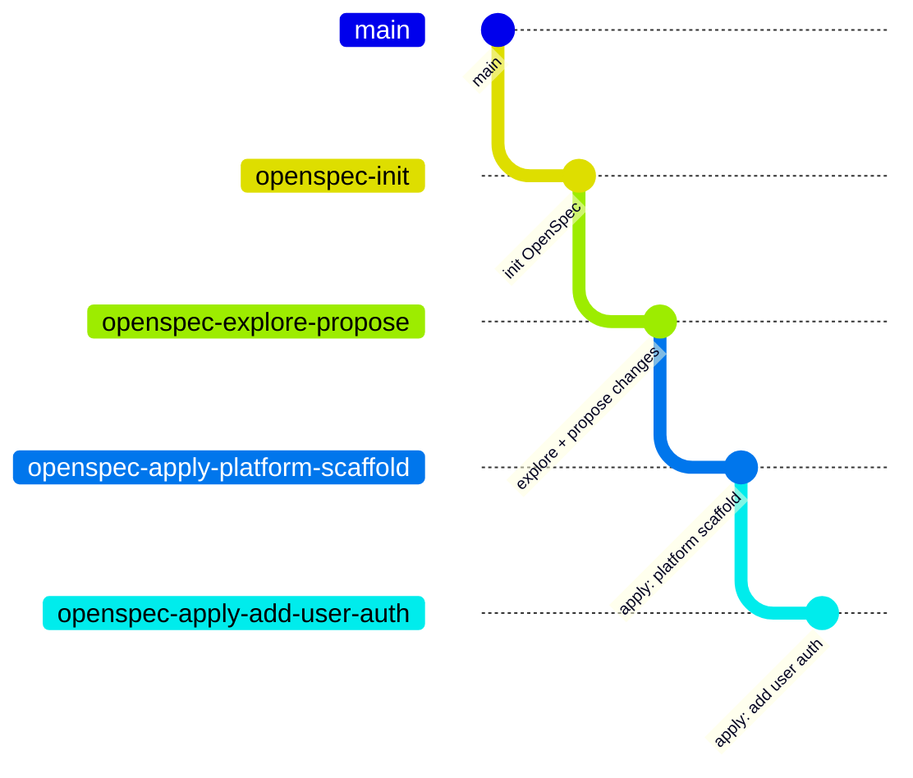

# TODO app

Multi-user TODO web app: React + Vite frontend, Spring Boot backend, PostgreSQL, Redis.
Product and tech requirements live in `project_description.md`.

Depending on the spec tool you will us there will be different prerequisites. Up to this
point, we only have played with ([OpenSpec](https://openspec.dev/), check any branch 
which name starts with `openspec`. Base on OpenSpec skills available, the first one is 
`openspec-init` where we set up OpenSec, defined which AI tools will be used, in this case
only Claude at the moment, although OpenSec supports multiple AI tools at the same time

We hope we can set up in the future other Spec Driven AI tooling like Github Spec Kit
and other similar tools, in order to try out their capabilites.

## Branch history

This is a demo project built step by step with OpenSpec. Each branch starts from the previous one:



```
main -> openspec-init -> openspec-explore-propose -> openspec-apply-platform-scaffold -> openspec-apply-add-user-auth
```
