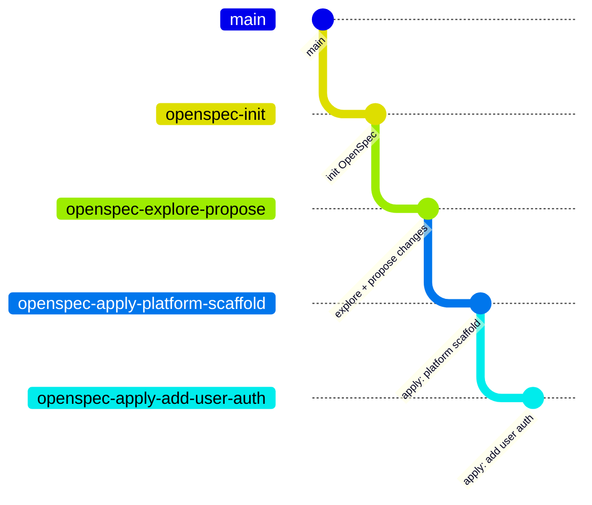

# TODO app

Multi-user TODO web app: React + Vite frontend, Spring Boot backend, PostgreSQL, Redis.
Product and tech requirements live in `project_description.md`; planned work lives in `openspec/`.

## Prerequisites

Versions below are what the project is developed and tested with. Newer minor versions should work.

| Tool                   | Version                 | Needed for                                                        |
| ---------------------- | ----------------------- | ----------------------------------------------------------------- |
| Docker Engine / Desktop | 25+ (tested with 29.x) | Running the stack **and** backend tests (Testcontainers)          |
| Docker Compose         | v2 plugin (`docker compose`) | Running the stack                                            |
| Git                    | any recent              | Cloning                                                           |
| JDK                    | **21** (Temurin or OpenJDK) | Backend outside Docker, `./mvnw verify`                       |
| Node.js                | **22 LTS**              | Frontend outside Docker (`npm ci`, tests, lint)                   |
| npm                    | bundled with Node       | Frontend                                                          |
| Maven                  | *not required*          | Provided by the wrapper `backend/mvnw` (Maven 3.9.9)              |

Only Docker is needed to **run** the app. Java and Node are only needed if you run tests or develop outside containers.
Check your setup with `docker --version`, `docker compose version`, `java -version` and `node -v`.

Free local ports: `5173` (frontend), `8080` (backend), `8025` (Mailpit). Change them in `.env` if they clash.

> **Docker Desktop on Linux:** Testcontainers looks for `/var/run/docker.sock` first. If backend tests are skipped or
> cannot find Docker, run them with `DOCKER_HOST=unix://$HOME/.docker/desktop/docker.sock ./mvnw verify`.
> The project pins Testcontainers 1.21.4, which is required to talk to Docker Engine 29 (older versions are rejected
> by it).

## Run the whole stack

```bash
cp .env.example .env
# edit .env and set JWT_SECRET (e.g. `openssl rand -base64 48`)
docker compose up --build      # start (add -d to detach)
docker compose down            # stop; add -v to also delete the database volume
```

`docker compose up` also reads `docker-compose.override.yml`, which bind-mounts source for the `dev` targets.
Set `BUILD_TARGET=prod` in `.env` for production-like images (nginx-served frontend, JRE-only non-root backend).

| Service  | URL                                   |
| -------- | ------------------------------------- |
| Frontend | http://localhost:5173                 |
| Backend  | http://localhost:8080/api/v1/health   |
| Mailpit  | http://localhost:8025 (caught emails) |

### Check that it works

Nothing product-facing exists yet (sign-in, TODO list and admin arrive in later changes), so a smoke check is:

1. `curl http://localhost:8080/api/v1/health` returns `{"status":"UP"}`.
2. Open http://localhost:5173. You are redirected to `/login` and see a "Sign in" heading (the TODO page is behind login).
3. `curl http://localhost:5173/api/v1/health` returns the same `UP`, proving the frontend proxy reaches the backend.
4. `curl -i http://localhost:8080/api/v1/anything` returns `401` with an `application/problem+json` body.
5. Open http://localhost:8025 to see Mailpit, which catches every email the backend sends (password reset links).

If `JWT_SECRET` is empty the backend refuses to start and logs that `JWT_SECRET` is required.

## Accounts, administrator and password recovery

- **Sign up** at http://localhost:5173/signup, then sign in at `/login`. Sign-up only ever creates regular users.
- **First administrator:** set `ADMIN_EMAIL`, `ADMIN_PASSWORD` and `ADMIN_FULL_NAME` in `.env` (all three or none; a partial
  set stops the backend, and so does an email that already belongs to a regular user). The account is created on startup
  if no admin exists yet. Admins land on `/admin/users` after signing in; regular users land on `/`.
- **Sessions** are a 24-hour JWT kept in the browser; signing out only discards it client-side, and a password reset does
  not revoke tokens already issued.
- **Password reset email** is sent from `MAIL_FROM` and links to `FRONTEND_ORIGIN/reset-password?token=...`. The link works
  once and expires after 60 minutes; at most 5 requests per email per hour.

### Check password recovery locally

1. Create an account, then open http://localhost:5173/forgot-password and submit its email.
2. Open http://localhost:8025 (Mailpit). A "Reset your password" email arrives within a couple of seconds.
3. Click the link in the email. It opens `http://localhost:5173/reset-password?token=...` and shows the "Set a new password" form.
4. Submit a password of 8+ characters. You land on the sign-in screen with a success message and can sign in with the new password.
5. Open the same link again: the page says the link no longer works and offers to request a new one.

## Run tests

```bash
# backend (Docker must be running for the Testcontainers tests)
cd backend && ./mvnw verify          # tests + 80% line-coverage gate (JaCoCo)

# frontend
cd frontend
npm ci
npm run lint
npm test                             # Vitest + React Testing Library + MSW
npm run test:coverage                # fails below 80% line coverage
npm run build
```

## Continuous integration

`.github/workflows/ci.yml` runs on pull requests and pushes to `main`: `backend` and `frontend` jobs (lint, tests, coverage),
then a `docker` job that builds the `prod` images (only if both pass; nothing is pushed).

## Branch history

This is a demo project built step by step with OpenSpec. Each branch starts from the previous one:



```
main -> openspec-init -> openspec-explore-propose -> openspec-apply-platform-scaffold -> openspec-apply-add-user-auth
```

## Layout

```
backend/    Spring Boot 3 (Java 21, Maven): controller / service / repository / entity / config / exception
frontend/   React + Vite + TypeScript: app, components, features, hooks, routing, store
docker-compose.yml, docker-compose.override.yml, .env.example
```
